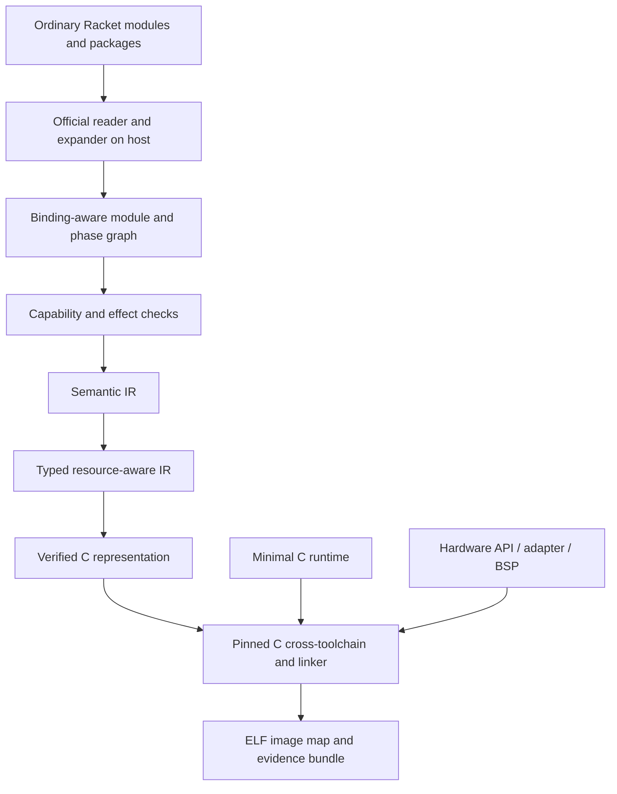

# Architecture baseline

Status: accepted layering and initial backend direction; all components below are planned. ABI layouts and language coverage remain proposed until their experiments pass.

## Owners and boundaries

| Planned component | Owns | Must not own |
| --- | --- | --- |
| Racket frontend | Official expansion integration, binding IDs, dependency phases, source origins | Reimplementation of hygiene or package resolution |
| Analysis | Reachability, types, effects, capability rejection and diagnostics | Quietly rewriting unsupported values |
| IR pipeline | Explicit semantics, pass pre/postconditions, resource facts | Board registers or SDK discovery |
| C backend | Defined C evaluation, ABI lowering, debug mapping | Scheduler, clock setup or inferred hardware policy |
| Device runtime | Required value operations, static initialization and fault hooks | Racket JIT, host packages or payment logic |
| Hardware API | Device-neutral operations and ownership contracts | Vendor register definitions |
| Adapter | Bare-metal or RTOS execution and interrupt integration | Application business decisions |
| BSP | Startup, vectors, linker sections, clocks, pins and board identity | Language semantics |
| Host build tool | Explicit inputs, toolchain invocation, reports and reproducibility | Ambient network dependency resolution during release builds |

## Expansion and dependency control

The default module language is `racket/base`; additional capabilities use ordinary `require`. The host retains full Racket tooling. Target admission depends on semantic/effect/resource analysis, with neither full `racket/base` nor full `racket` coverage as an objective. The [language contract](language-contract.md) owns this policy; the [assessment procedure](compatibility-assessment.md) defines its review boundaries. This policy is accepted independently of the proposed first runtime profile.

Use official syntax objects and resolved bindings, never textual matching of names such as `+`. A macro may expand to target-supported code while using rich host libraries at expansion time. Conversely a simple-looking `require` can introduce unsupported target initialization. Walk and record module imports, phase shifts, initialization order and reachable runtime bindings. Expansion can execute host code; isolate it in a separate OS process/container with explicit filesystem/network access, time and memory limits. A Racket namespace is not an adversarial-code sandbox.

Before analysis, freeze package checksums, Racket version, environment inputs and feature profile. Do not discard unknown effects during dead-code elimination to manufacture compatibility. Cross-compilation must distinguish host fixnum properties and target data layout; host evaluation must not precompute target-dependent behavior without a proof.

## Data and execution

The first profile investigates bounded, allocation-free execution with statically known call targets. It does not convert general Racket arithmetic to machine integers by default. Range proofs can justify an unboxed representation while preserving mathematical results. If overflow remains possible and no faithful implementation is available, reject the program with a source diagnostic. Explicit hardware-width APIs have their own named semantics.

Keep semantic IR independent of word width; introduce concrete layout and ownership in later IR. Tail position remains explicit through lowering. Neither C recursion nor `-O2` proves proper tail recursion. Any accepted tail-recursive cycle needs a verified bounded-stack lowering. Fault handling is defined before initialization or interrupt execution is supported.

## Family composition and source layout

Kiln is a domain-specific compiler platform, not an orchestrator for the family libraries. Rivet and Glaze serve future host graphical tools only. Keel is evaluated if two real consumers need a shared transport contract; it is not imported onto the MCU by default. Product rights use Permit and optional Commerce outside the compiler/runtime. Family libraries are consumed through normal packages, never copied or compiled from handwritten source lists.

Current layout is intentionally small: `docs/` contracts and ADRs, `kiln-doc/` installable Scribble entry, `kiln-tools/` foundation checks, `kiln-test/` checker regression tests and `.github/` governance automation. When implementation is authorized, introduce separate collections for frontend, IR, backend and CLI, plus C runtime and target directories, as each gains real code. Do not create empty compiler stubs that imply working APIs. Build artifacts belong in ignored `build/`; third-party SDKs remain external pinned inputs.

## Evolution rules

M1 is currently a framework-and-contract phase. The [reference-product brief](reference-product.md), compatibility procedure and [evidence contract](evidence-contract.md) must be reviewed before implementing experiments or compiler components. Proposed experiments describe future evidence; writing their plan does not authorize a compiler sprint or establish a passing result.

Passes consume validated versions and either produce valid output or fail with a diagnostic. No partially emitted firmware is a successful build. Versioned IR and ABI remain internal until demonstrated by real consumers; avoid premature binary compatibility promises. A later backend must reuse the same semantic oracle and capability rules. Native C is the only initial backend; VM and direct native backends require new ADRs and product evidence.
